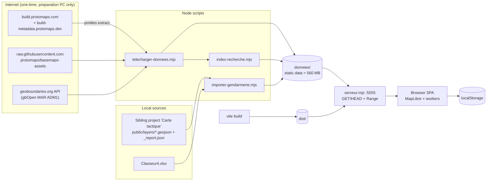
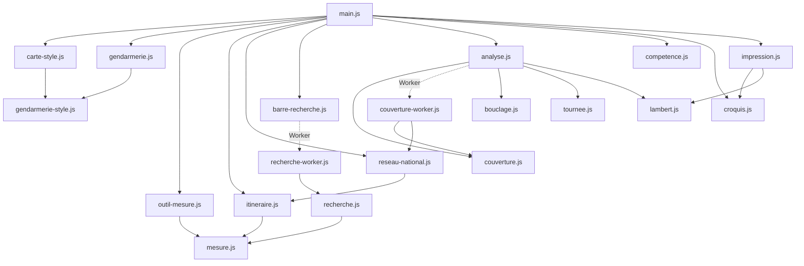
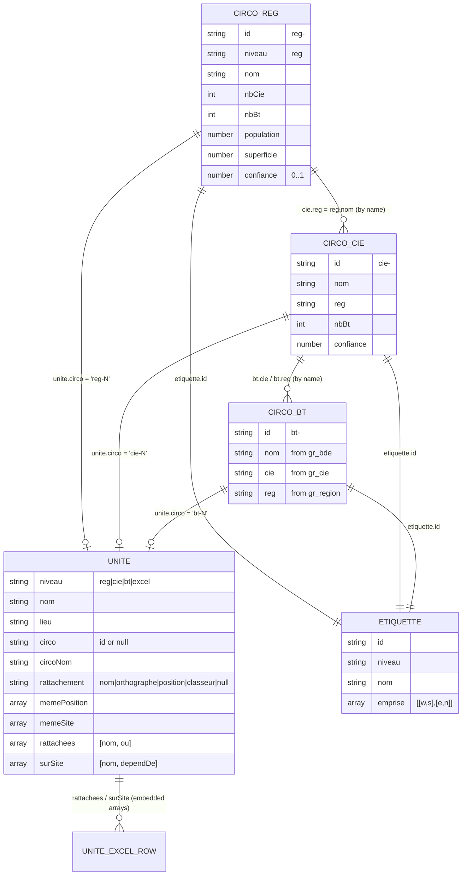
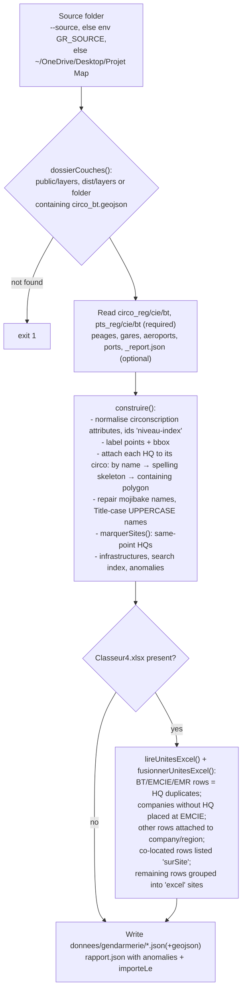
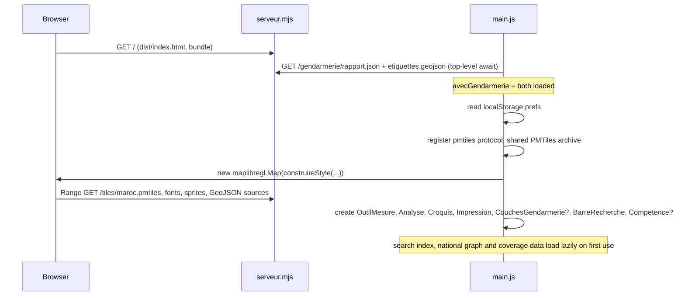
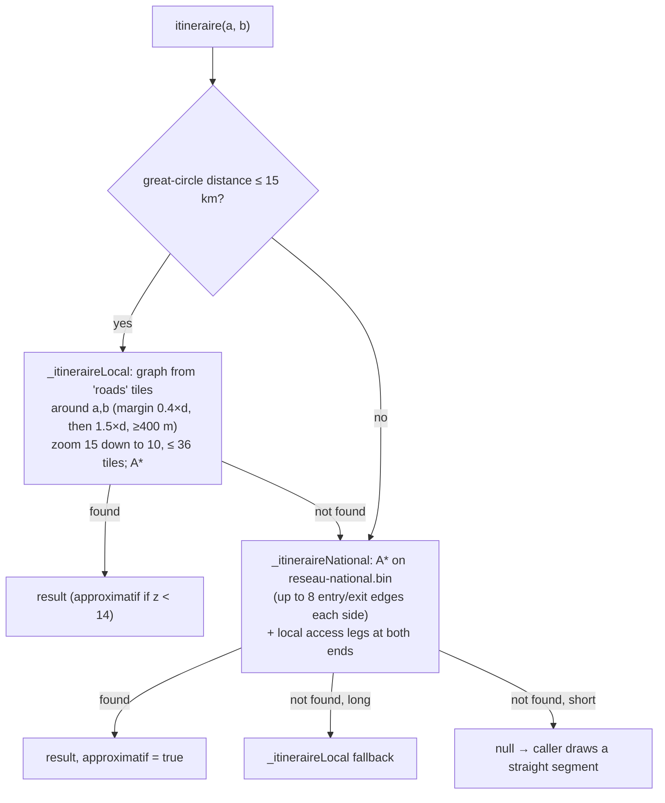
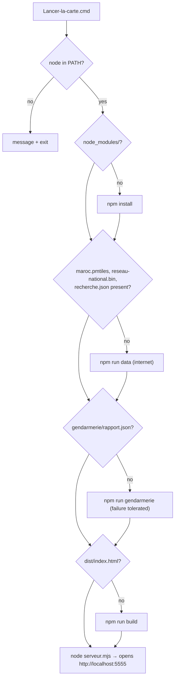

# PROJECT_MAP — `maroc-carte-offline`

> Technical map of the code as it exists in this folder. Everything below was taken from the
> source files, configs and generated data. Nothing here describes planned work unless it is
> explicitly labelled **Recommendation** (section 17), and no roadmap or TODOs exist in the repo.
>
> Language note: the code, identifiers, comments, UI strings and README are in **French**
> (with an Arabic UI translation). This document is in English and keeps the French
> identifiers verbatim (`carte` = map, `mesure` = measurement, `croquis` = sketch,
> `impression` = printing, `circonscription` = jurisdiction area, `brigade/compagnie/région`
> = Gendarmerie echelons, `chef-lieu` = unit headquarters, `donnees` = data).

---

## 0. TL;DR

| Question | Answer |
|---|---|
| What is it? | An **offline operational map** of Morocco for the **Gendarmerie Royale**: OpenStreetMap basemap + Gendarmerie jurisdictions/units, with offline search, road routing, coverage analysis, sketching and printing. |
| Architecture | **Static single-page app** (vanilla JS + MapLibre GL, bundled by Vite) + a **~140-line dependency-free Node static file server** with HTTP Range support. |
| Backend / API / DB | Dependency-free local API in `serveur/` (accounts, sessions, region-filtered data, conflict workflow; §7.23–7.24). No database: JSON state in `etat/` (atomic writes, append-only audit). Map data are pre-built static files under `donnees/`. |
| Data | ~560 MB generated once: PMTiles vector tiles (525 MB), fonts, sprites, a binary national road graph, a JSON search index, and Gendarmerie GeoJSON layers imported from a sibling project ("Carte tactique") + an Excel workbook. |
| State | Only per-browser `localStorage` (preferences, sketch, analysis and print settings) and the URL hash. |
| Deployment | (a) double-click `Lancer-la-carte.cmd` on Windows, (b) `npm start`, (c) air-gapped **Docker** bundle produced by `npm run transfert`. |
| Tests | `node --test`: **225 tests, all passing** (2026-10-16). Pure-logic modules plus real-HTTP server tests (`serveur/*.test.mjs`); browser checks are run by hand (headless Chrome scripts, not in the repo). |
| Barages | Opt-in layer of ≈ 1 000 **simulated** checkpoints placed **on roads** (`npm run barages` → `donnees/barages/barages.json`), filterable by REG/CIE/BT/type/faction/origin, editable in a browser-local overlay with export — see §7.15. |
| Version control | The folder is **not a git repository** (a `.gitignore` exists, but no `.git/`). |

---

## 1. Purpose and tech stack

### 1.1 Purpose (from `README.md`, `package.json`, code)

A full-screen map of the Kingdom of Morocco (Southern Provinces included) that runs on a single
PC or a LAN **with no internet connection** once the data are prepared. It overlays the
territorial organisation of the Gendarmerie Royale:

- 28 regional commands (`reg`), 90 company areas (`cie`), 504 territorial-brigade areas (`bt`),
  their headquarters (`chefs-lieux`), plus extra units from an Excel workbook;
- infrastructure points (tolls, rail stations, airports, ports);

and provides operational tools: offline search, road-following distance measurement,
jurisdiction lookup ("compétence territoriale"), brigade coverage (travel-time raster),
intervention zones (isochrones), cordon/roadblock planning ("bouclage"), patrol-route
optimisation ("tournée"), sketching with GeoJSON/KML import/export, Lambert Maroc coordinates,
and A4/A3 print/PDF.

Counts in the current imported data (`donnees/gendarmerie/rapport.json`, imported 2026-10-06):
circonscriptions reg 28 / cie 90 / bt 504; chefs-lieux reg 28 / cie 93 / bt 501;
infrastructures: 92 tolls, 115 stations, 37 airports, 26 ports; Excel workbook: 1 978 rows,
606 duplicates of HQs, 1 372 attached to an HQ, 4 standalone sites, 211 rows without
coordinates, 7 companies created from their EMCIE position. Search index: 104 107 entries
(+ 2 024 Gendarmerie entries).

### 1.2 Stack

| Layer | Technology | Where |
|---|---|---|
| Runtime | Node.js **≥ 22.12** (`engines`), ES modules (`"type": "module"`) | `package.json` |
| Map rendering | **MapLibre GL JS 6** (`maplibre-gl ^6.11.2`) | `src/main.js`, `src/carte-style.js` |
| Tiles | **PMTiles** single-file archive (`pmtiles ^4.5.0`), Protomaps basemap (`@protomaps/basemaps ^5.7.2`) | `donnees/tiles/maroc.pmtiles` |
| Tile decoding (routing/search) | `@mapbox/vector-tile ^3`, `pbf ^5` | `src/itineraire.js`, scripts |
| Excel import | `xlsx ^0.18.5` (SheetJS) | `scripts/importer-gendarmerie.mjs` |
| Bundler / dev server | **Vite 8** (`vite ^8.3.2`), ES-module workers | `vite.config.js` |
| Style validation (tests) | `@maplibre/maplibre-gl-style-spec ^26.4.4` | `src/gendarmerie-style.test.mjs` |
| UI | Plain DOM + CSS (no framework), custom properties for theming, RTL support | `index.html`, `src/style.css`, `src/dom.js` |
| Background compute | 2 Web Workers (search, coverage) + `OffscreenCanvas` | `src/recherche-worker.js`, `src/couverture-worker.js` |
| Server | `node:http` only (zero dependencies) | `serveur.mjs` |
| Tests | Node built-in test runner (`node --test`) + `node:assert/strict` | `*.test.mjs` |
| Container | Docker multi-stage, `node:22-alpine` | `Dockerfile`, `docker/` |
| External CLI | `go-pmtiles` binary (`tools/pmtiles.exe`, 57 MB, git-ignored) | used by `npm run data` |

---

## 2. Folder / file structure

```
maroc-carte-offline/
├── package.json               npm scripts + deps (see §12)
├── package-lock.json
├── vite.config.js             publicDir = donnees/, not copied to dist/; ES workers; dev port 5174
├── index.html                 the only page: map container, rail, 6 panels, inspector, status bar
├── serveur.mjs                offline static server (dist/ + donnees/), HTTP Range, port 5555
├── serveur.test.mjs
├── Lancer-la-carte.cmd        Windows launcher (install → data → import → build → serve)
├── Dockerfile                 2-stage image: build with Vite, run serveur.mjs + donnees/
├── .dockerignore              only package*.json, index.html, vite.config.js, src/, serveur.mjs, donnees/ enter the image
├── .gitignore                 ignores node_modules/, dist/, donnees/, tools/, Classeur4.xlsx, .ruff_cache/, transfert/
├── README.md                  user documentation (French) — accurate w.r.t. the code
├── Classeur4.xlsx             service workbook of units (sensitive, git-ignored)
│
├── src/                       front-end (bundled by Vite) — also imported by Node scripts
│   ├── main.js                entry point: wiring, i18n strings, prefs, panels, context menu
│   ├── dom.js                 `element()` helper
│   ├── style.css              all styles (themes, layout, mobile, print sheet)
│   ├── assets/                logo-gendarmerie.png, logo-gendarmerie-64.png (favicon)
│   ├── carte-style.js         MapLibre style builder; Morocco adaptations; 12 regions
│   ├── gendarmerie-style.js   Gendarmerie sources/layers, zoom→echelon logic, selection veil
│   ├── gendarmerie.js         CouchesGendarmerie: hover tooltip, click → inspector "fiches"
│   ├── competence.js          point-in-jurisdiction lookup + HQ ("siège") of the area
│   ├── mesure.js              pure geometry: haversine, snapping, road-gap, formatting
│   ├── outil-mesure.js        OutilMesure: interactive distance / gap tool on the map
│   ├── itineraire.js          local road graph from tiles, A*, Dijkstra, ReseauRoutier
│   ├── itineraire-worker.js   runs ReseauRoutier off the main thread (serial queue, cancellable requests)
│   ├── itineraire-distant.js  ReseauRoutierDistant: same async API as ReseauRoutier, backed by the worker
│   ├── diagnostic-rendu.js    detects software WebGL (SwiftShader, llvmpipe…) → "carte lente" banner
│   ├── reseau-national.js     national road graph: build, binary (de)serialise, A*
│   ├── recherche.js           search index: normalisation, scoring, coordinates parsing
│   ├── recherche-worker.js    worker wrapper for the search index
│   ├── barre-recherche.js     BarreRecherche: search box UI, results, marker; enDMS()
│   ├── analyse.js             Analyse: coverage, intervention zone, bouclage, tournée panel
│   ├── couverture.js          pure: multi-source Dijkstra, Mercator grid, rasterise, stats
│   ├── couverture-worker.js   worker: coverage / isochrone → PNG blob + typed arrays
│   ├── bouclage.js            pure: road crossings of a circle, bearings
│   ├── tournee.js             pure: Held-Karp (≤12) / nearest-neighbour + 2-opt
│   ├── croquis.js             Croquis: sketch tool, symbols, localStorage, GeoJSON/KML I/O
│   ├── impression.js          Impression: hidden hi-DPI map render + A4/A3 sheet composition
│   ├── lambert.js             WGS84 ↔ Lambert Maroc (Merchich, EPSG 26191/2/4/5)
│   ├── barages.js             pure: checkpoint record contract, seeded generation, validation, BT→CIE→REG, filters, layers
│   ├── couche-barages.js      CoucheBarages: loading boundary, map layers, panel filters/legend, fiche, icons
│   ├── optimisation.js        pure: barage data-quality checks, duplicate engine, proposals, apply/undo planning, history
│   ├── optimisation-worker.js runs optimisation.analyser off the main thread (progress, cancel)
│   ├── optimisation-ui.js     TableauOptimisation: "Optimisation des barrages" dashboard + map highlight layers
│   ├── proximite.js           pure: proximity rules, grid pair search, alerts, distance bands, relocation effect, road distances via engine, history
│   ├── proximite-ui.js        CentreProximite: Proximité, Déplacements, Carte de chaleur tabs (alerts, draggable relocation with live validation, heatmap, creation preview, zone navigation)
│   ├── dedoublonnage.js       pure: confirmed/potential duplicates, canonical record, removal plan, undo, operation log
│   ├── dedoublonnage-ui.js    CentreDedoublonnage: Doublons tab (analyse, launch, undo, history, map)
│   └── *.test.mjs             15 test files (see §13)
│
├── scripts/                   Node CLI scripts (run via npm)
│   ├── telecharger-donnees.mjs   `npm run data`: tiles, fonts, sprites, regions, national graph, search index
│   ├── index-recherche.mjs       builds donnees/data/recherche.json from local tiles
│   ├── importer-gendarmerie.mjs  `npm run gendarmerie`: Carte tactique layers + Excel → donnees/gendarmerie/
│   ├── preparer-transfert.mjs    `npm run transfert`: docker build/save + install bundle (warns if simulated barages are included)
│   ├── generer-barages.mjs       `npm run barages`: simulated checkpoints on roads (reads maroc.pmtiles) → donnees/barages/barages.json; `--verifier`
│   └── *.test.mjs                3 test files
│
├── docker/                    templates copied into the transfer bundle (placeholders __IMAGE__, __ARCHIVE__, …)
│   ├── docker-compose.yml     read_only, cap_drop ALL, no-new-privileges, port 5555
│   ├── installer.sh / installer.ps1   verify SHA256SUMS → docker load → compose up
│   └── LISEZMOI.md            install guide for the air-gapped server
│
├── donnees/      (generated, git-ignored, ≈ 560 MB; served at the web root)
│   ├── tiles/maroc.pmtiles                 525 MB, Protomaps extract, z0–15, bbox -17.5,20.5,-0.9,36.2
│   ├── fonts/Noto Sans {Regular,Medium,Italic}/*.pbf   glyph ranges (14 MB)
│   ├── sprites/v4/{light,dark}[@2x].{json,png}
│   ├── data/regions.geojson               12 regions (geoBoundaries) — used by scripts only
│   ├── data/regions-limites.geojson       inner boundaries between regions (dashed line layer)
│   ├── data/regions-etiquettes.geojson    one label point per region
│   ├── data/reseau-national.bin           12 MB, binary national road graph ('MAR2')
│   ├── data/recherche.json                6 MB, search index v1
│   ├── barages/barages.json                160 kB, SIMULATED checkpoints (opt-in, `npm run barages`), see §7.15
│   └── gendarmerie/                        3.8 MB, see §5
│       ├── circo-reg.geojson, circo-cie.geojson, circo-bt.geojson
│       ├── unites.geojson, etiquettes.geojson, infrastructures.geojson
│       ├── recherche-gendarmerie.json, rapport.json
│
├── dist/         (Vite build output, git-ignored)  index.html + assets/ (main bundle, 3 workers, css, logos)
├── transfert/    (git-ignored) carte-gendarmerie-1.0.0/ : .tar image (544 MB), compose, installers, LISEZMOI.md, SHA256SUMS
├── tools/        (git-ignored) pmtiles.exe + its LICENSE/README
├── node_modules/ (88 MB)
├── .ruff_cache/  Python linter cache — there is no Python code in the project
└── .claude/      empty
```

---

## 3. Routes, pages and "API" endpoints

### 3.1 There is no application API

`serveur.mjs` is a **pure static file server**. It accepts only `GET` and `HEAD`
(any other method → `405`, `Allow: GET, HEAD`). Every request path is resolved first in
`dist/`, then in `donnees/` (`resoudre()`), with path-traversal protection.

| Behaviour | Detail (`serveur.mjs`) |
|---|---|
| Path resolution | `decodeURIComponent`, query stripped, `\0` rejected, trailing `/` → `index.html`, `path.posix.normalize`, result must stay inside the served folder |
| Range requests | `bytes=a-b`, `bytes=a-`, `bytes=-n` → `206` + `Content-Range`; multi-range or invalid → `416` (`lirePlage()`) |
| Headers | `Content-Type` from a small extension map, `Accept-Ranges: bytes`, `Cache-Control: no-cache`, weak `ETag` (size + mtime) and `Last-Modified`; a matching `If-None-Match` on a non-Range request → `304` (measured: warm reload 10.5 MB → 0.5 MB; duplicate per-load downloads of the circonscription files become 304s) |
| Errors | missing file → `404 Introuvable` |
| Startup checks | refuses to start if `dist/index.html` or `donnees/tiles/maroc.pmtiles` is missing; warns if `donnees/gendarmerie/rapport.json` is missing |
| Browser | opens the default browser unless `--sans-navigateur` (Windows `cmd /c start`, macOS `open`, Linux `xdg-open`) |
| Port conflict | `EADDRINUSE` → explanatory message, exit 1 |

### 3.2 URLs actually requested by the front-end

All URLs are built from `window.location.origin` (`origine`), so the same code works under
Vite dev (5174) and `serveur.mjs` (5555).

| URL | Consumer | Notes |
|---|---|---|
| `/` , `/assets/*` | browser | Vite build output (`dist/`) |
| `/tiles/maroc.pmtiles` | MapLibre via `pmtiles://` protocol **and** `ReseauRoutier` (same `PMTiles` instance, shared cache) | Range requests |
| `/fonts/{fontstack}/{range}.pbf` | MapLibre glyphs | |
| `/sprites/v4/{light\|dark}` | MapLibre sprite | |
| `/data/regions-limites.geojson`, `/data/regions-etiquettes.geojson` | style sources `regions-limites`, `regions-etiquettes` | |
| `/data/recherche.json` | search worker | loaded on first focus of the search box |
| `/data/reseau-national.bin` | `ReseauNational` (main thread) and `couverture-worker.js` | loaded lazily |
| `/gendarmerie/rapport.json`, `/gendarmerie/etiquettes.geojson` | `main.js` at boot (top-level `await`) — both must load for Gendarmerie features to be enabled | |
| `/gendarmerie/circo-{reg,cie,bt}.geojson`, `unites.geojson`, `infrastructures.geojson` | style sources `gr-*`; `Competence`; `Analyse` (`unites.geojson`, `circo-reg.geojson` as territory mask) | |
| `/gendarmerie/recherche-gendarmerie.json` | search worker (optional index, merged) | |
| `/barages/barages.json` | `CoucheBarages.charger()` on first activation of the layer | 404 (or the dev server's HTML fallback) → "jeu absent" hint |

### 3.3 Client-side "pages"

Single page (`index.html`). No router. Navigation state:

- **URL hash** `#vue=…` — MapLibre `hash: 'vue'` keeps zoom/centre/bearing/pitch in the URL.
- **Panels** (left rail, one at a time; persisted as `prefs.onglet`):
  `couches` (layers), `mesure` (measure), `analyse`, `croquis` (sketch), `impression` (print), `affichage` (display).
- **Inspector** `#inspecteur` (right) — unit / jurisdiction / infrastructure "fiche".
- **Status bar** `#etat` — cursor coordinates (DMS or Lambert) + zoom, displayed echelon, coverage hover value.
- **Map popups** — right-click coordinates/jurisdiction popup; search result popup.

### 3.4 Worker message protocols (internal "APIs")

| Worker | In | Out |
|---|---|---|
| `itineraire-worker.js` | `{type:'init', urlTuiles, urlNational}` · `{type:'appel', id, methode: 'itineraire'\|'lignes'\|'matrice', args}` · `{type:'annuler', id}` | `{id, resultat}` · `{id, erreur}` · `{id, annule:true}` · `{id, progression:[f,t]}`. Requests run one at a time; `ReseauRoutierDistant` cancels a superseded request on the same `canal` (measure preview). |
| `optimisation-worker.js` | `{type:'analyser', id, instantane, regles, urls:{circos:{reg,cie,bt}, tuiles}}` · `{type:'proximite', id:'P-n', enregistrements, regles, urls}` · `{type:'candidats', id:'C-n', zone:{niveau,id}, pasM, max, urls}` · `{type:'doublons', id:'D-n', instantane, regles, portee:{perimetre, inclureAjoutsLocaux}, urls}` · `{type:'annuler', id}` | `{id, progression:[fait,total,etape]}` · `{id, resultat:{constats, analyses, exclus, annule}}` · `{id, erreur}`. Read-only; loads the circonscriptions itself, and road tiles only when the road rule is on. |
| `recherche-worker.js` | `{type:'charger', url, optionnels}` · `{type:'chercher', id, url, optionnels, requete, options:{centre, langue, max}}` | `{type:'pret', taille}` · `{type:'erreur', message}` · `{id, resultats}` · `{id, erreur}` |
| `couverture-worker.js` | `{id, urlReseau, urlMasque, sources:[[lon,lat]…], limite?}` (no `limite` = whole territory coverage; with `limite` seconds = isochrone around `sources[0]`) | `{id, image: Blob(PNG), grille:{x0,y0,d,largeur,hauteur,coins}, temps: Float32Array, proprio: Int32Array, stats:{parts, horsAtteinte, km2}}` (typed arrays transferred) · `{id, erreur}` |

### 3.5 CLI "endpoints" (npm scripts)

| Command | Script | Network? | Output |
|---|---|---|---|
| `npm run dev` | `vite` | no | dev server http://localhost:5174, serves `donnees/` as public dir |
| `npm run build` | `vite build` | no | `dist/` |
| `npm start` | `node serveur.mjs` | no | http://localhost:5555 |
| `npm run data [-- --force]` | `scripts/telecharger-donnees.mjs` | **yes** (tiles, fonts, sprites, regions) | `donnees/{tiles,fonts,sprites,data}` |
| `npm run gendarmerie [-- --source <dir>]` | `scripts/importer-gendarmerie.mjs` | no | `donnees/gendarmerie/*` |
| `npm run barages [-- --graine N --nombre N]` · `npm run barages -- --verifier` | `scripts/generer-barages.mjs` | no | `donnees/barages/barages.json` (simulated, on roads); `--verifier` checks validity, BT links and road placement (exit 1 on failure) |
| `npm test` | `node --test` | no | 89 tests |
| `npm run transfert [-- --plateforme linux/arm64]` | `scripts/preparer-transfert.mjs` | yes (Docker base image + npm ci inside build) | `transfert/carte-gendarmerie-<version>/` |

---

## 4. Architecture

### 4.1 System overview



### 4.2 Front-end module graph



### 4.3 Front-end design

- **No framework.** `main.js` is a top-level module (uses top-level `await`) that instantiates
  feature classes and wires them with callbacks. DOM is created with `document.createElement`
  / `element()`; text always via `textContent` (no user data through `innerHTML`; the only
  `innerHTML` is a static north-arrow SVG in `impression.js`).
- **Feature classes** (each owns its MapLibre source/layers and its panel DOM):
  `OutilMesure`, `Analyse`, `Croquis`, `Impression`, `CouchesGendarmerie`, `BarreRecherche`,
  `Competence`, `ReseauRoutier`, `ReseauNational`, `IndexRecherche`/`Recherche`.
- **Pure modules** (no DOM / MapLibre, unit-tested, also imported by Node scripts):
  `mesure.js`, `itineraire.js` (graph part), `reseau-national.js`, `recherche.js`,
  `couverture.js`, `bouclage.js`, `tournee.js`, `lambert.js`, `carte-style.js`,
  `gendarmerie-style.js`, `competence.js` helpers, `impression.js` layout helpers,
  `croquis.js` import/export helpers.
- **Style rebuilds.** Theme or language change → `carte.setStyle(construireStyle(...), {diff:false})`.
  Every feature re-installs its own sources/layers on the `style.load` event
  (`mesure.installer`, `analyse.installer`, `croquis.installer`, `gendarmerie._rendreSelection`).
  Echelon/units/infra toggles are applied **without** a style reload (`CouchesGendarmerie.regler`).
- **Tool exclusivity.** Only one tool takes map clicks: measure, analysis tools
  (`bouclage`/`tournee`), sketch tools. Each tool's `surOutil` callback stops the others and
  closes the inspector (`main.js` `preparerMesure`, `Analyse({surOutil})`, `Croquis({surOutil})`).
  `CouchesGendarmerie` ignores clicks when `mesureActive(e)` is true (any tool active, or the
  click hits a sketch element).
- **i18n.** French/Arabic. `main.js` `TEXTES` covers `index.html` (`data-texte`,
  `data-texte-aria`, `data-placeholder` attributes); each feature module also carries its own
  `TEXTES` (`outil-mesure.js`, `analyse.js`, `croquis.js`, `impression.js`, `recherche.js`).
  Arabic sets `dir="rtl"`. Map labels use Protomaps `lang` option.
- **Theming.** `data-theme` attribute on `<html>`; CSS custom properties (`--gr-reg`, …);
  basemap via `namedFlavor('light'|'dark')`. Printing always uses the light style
  (`stylePourImpression()` rebuilds a light style and re-inserts runtime layers).
- **Responsive.** `@media (max-width: 900px)` and `(max-width: 640px)`: rail at the bottom,
  panels/inspector as sheets; the panel starts closed on ≤ 640 px.

### 4.4 Map layer stack (bottom → top)

1. Protomaps basemap layers (adapted by `adapterCouchesMaroc`) up to the first `symbol` layer
2. `regions-trait` (dashed inner region boundaries) + Gendarmerie `sousLibelles`:
   `gr-{reg,cie,bt}-fond`, `gr-{reg,cie,bt}-trait`, `gr-selection-voile`, `gr-selection-trait`
3. Coverage/isochrone raster `analyse-temps` (inserted before the first `gr-*` or `symbol` layer)
4. Basemap labels (symbol layers)
5. `regions-nom`, then Gendarmerie `dessus`: `gr-{reg,cie,bt}-nom`, `gr-infra-point`,
   `gr-infra-nom`, `gr-unite-excel`, `gr-unite-excel-nom`, `gr-unite-{bt,cie,reg}`,
   `gr-unite-nom-{bt,cie,reg}`
6. Runtime layers added on `style.load`: `mesure-*`, `analyse-*`, `croquis-*`; `barages-symbole`, `barages-nom`
   are inserted just below the first of these (above all Gendarmerie layers).

### 4.5 "Backend"

`serveur.mjs` only (see §3.1). In development, Vite serves `donnees/` as `publicDir`; in
production `dist/` and `donnees/` are served side by side (`vite.config.js` comment:
`copyPublicDir: false`). The Docker image runs `node serveur.mjs --sans-navigateur` with
`HOTE=0.0.0.0 PORT=5555`.

---

## 5. Data layer (there is no database)

> **Database tables, relationships, RLS, migrations: none exist.** There is no SQL/NoSQL
> database, no ORM, no schema migration system and no row-level security. The equivalents are
> immutable static files regenerated by scripts, versioned by a format marker
> (`VERSION_INDEX = 1` for search indexes, `'MAR2'` signature for the road graph). The only
> mutable state is browser `localStorage`.

### 5.1 Static data files and their "schemas"



Relationships are **by name or by id string**, not by foreign keys; they are resolved at
import time by `scripts/importer-gendarmerie.mjs` (`construire`, `fusionnerUnitesExcel`,
`marquerSites`).

| File | Producer | Schema / notes |
|---|---|---|
| `gendarmerie/circo-{reg,cie,bt}.geojson` | `construire()` | FeatureCollection of Polygon/MultiPolygon, coordinates rounded to 1e-5°. Feature `id` = index; properties as in the diagram. `bt.superficie` rounded. |
| `gendarmerie/unites.geojson` | `construire()` + `fusionnerUnitesExcel()` | Points. Common: `niveau, nom, lieu, cie, reg, population, superficie, nbCie, nbBt, circo, circoNom, rattachement`. Optional arrays: `memePosition` (same echelon within 30 m → source anomaly), `memeSite` (different echelon within 30 m), `rattachees` (`[nom, null \| hostName \| 'site']`), `surSite` (`[nom, parentName]`). `niveau:'excel'` sites: `nom, etiquette ("X +n"), compagnie, regroupement, rattachement, unites[]`. |
| `gendarmerie/etiquettes.geojson` | `construire()` | One label point per circonscription (pole-of-inaccessibility style grid search), `emprise` bbox for "Aller à". |
| `gendarmerie/infrastructures.geojson` | `construire()` | Points `{type: peage\|gare\|aeroport\|port, nom, nomAr, iata}`; French and Arabic split from the source name by `separerNoms`. |
| `gendarmerie/recherche-gendarmerie.json` | `construire()` + Excel step | Same format as `recherche.json`; kinds `gr_reg, gr_cie, gr_bt, gr_excel`. |
| `gendarmerie/rapport.json` | `principal()` | `{fictif, circonscriptions, chefsLieux, infrastructures, anomalies:[{niveau:'info'\|'attention', message}], excel?, source, importeLe}` — `fictif:true` shows the "Données fictives" banner. |
| `data/recherche.json` | `index-recherche.mjs` | `{version:1, contextes:[[fr,ar]], kinds:[osmKind], e:[[type, nomFr, nomAr, lon×1e5, lat×1e5, rang 0–100, ctx\|-1, kind\|-1, autresNoms]]}`; `type` indexes `TYPES = region, ville, village, quartier, lieu, rue, commandement, compagnie, brigade` (`src/recherche.js`). |
| `data/reseau-national.bin` | `reseau-national.js` `serialiser` | Little-endian: `'MAR2'` u32, nbNoeuds u32, nbArcs u32, reserved u32, `lon f32[n]`, `lat f32[n]`, `debut u32[n+1]` (CSR), `cibles u32[m]`, `poids f32[m]` (metres), `vitesses u8[m]` (km/h). |
| `data/regions*.geojson` | `telecharger-donnees.mjs` | geoBoundaries ADM1 (`shapeName`, `shapeISO`); `regions-limites` = only segments shared by ≥ 2 regions, chained into lines; `regions-etiquettes` = label points. |
| `tiles/maroc.pmtiles` | `pmtiles extract` from the latest Protomaps daily build | bbox `-17.5,20.5,-0.9,36.2`, maxzoom 15. Layers used in code: `roads`, `places`, `pois`, `boundaries`. |

### 5.2 Browser storage (`localStorage`)

| Key | Owner | Content |
|---|---|---|
| `maroc-carte:prefs:v1` | `main.js` | `{theme, langue, regions, priorite, echelon, unites, excel, infra, coords, onglet}` — validated on read |
| `maroc-carte:analyse:v1` | `analyse.js` | `{duree, rayon, filtre, boucle}` |
| `maroc-carte:croquis:v1` | `croquis.js` | sketch FeatureCollection; synced across tabs via the `storage` event |
| `maroc-carte:impression:v1` | `impression.js` | `{format, orientation, echelle, quadrillage, titre, mention}` (print **notes are not persisted**) |
| `maroc-carte:barages:v1` | `couche-barages.js` | checkpoint filters `{reg, cie, bt, type, faction, origine}` (normalised against the loaded data); the on/off switch is `prefs.barages` (default `false`) |
| `maroc-carte:optimisation:regles:v1` | `optimisation-ui.js` | dashboard rules (validated by `validerRegles`; invalid → defaults) |
| `maroc-carte:optimisation:historique:v1` | `optimisation-ui.js` | analysis sessions `{sessions:[{id, date, auteur, regles, perimetre, versionDonnees (content fingerprint), constats (≤ 2000), enregistrements (values at analysis time), decisions, evenements}]}`, ≤ 20 sessions; on quota errors the oldest sessions are dropped |
| `maroc-carte:optimisation:proximite:regles:v2` | `proximite-ui.js` | proximity parameters `{distanceMaxKm, faction, origine, perimetre, inclureAjoutsLocaux, maxCandidats}` (key `…:regles:v2`) |
| `maroc-carte:optimisation:chaleur:regles:v1` | `proximite-ui.js` | heatmap parameters `{distanceMaxKm, faction, origine, perimetre}` |
| `maroc-carte:optimisation:proximite:v1` | `proximite-ui.js` | `{analyses (≤ 20, parameters + stats + ≤ 1000 alert summaries), propositions (≤ 200, avant/après, effect, status, journal entry for undo), evenements (≤ 500)}` |
| `maroc-carte:optimisation:dedoublonnage:v1` | `dedoublonnage-ui.js` | duplicate rules `{seuilConfirmeM, seuilPotentielM, exigerMemeNom, fusionner, criteres}` |
| `maroc-carte:optimisation:operations:v1` | `dedoublonnage-ui.js` | optimisation log `{operations:[{id, date, perimetre, regles, detectes, supprimes (full records), fusions (avant/après), conserves, statut, erreurs, editionsAvant (complete overlay backup), editionsApres}]}`, ≤ 20; written **before** the overlay; an `en-cours` entry found at load is resolved by comparing the overlay with its before/after copies |
| `maroc-carte:barages-affichage:v1` | `couche-barages.js` | `{actifs, retires}` visibility of active / historical barage layers |
| `maroc-carte:barages-editions:v1` | `couche-barages.js` | local edit overlay `{ajouts: [records], modifs: {id: fields}, suppressions: [ids], retraits: [{id, barageId, source: 'fichier'\|'local', barage (full copy), retireLe, restaureLe, motif}]}` applied on top of `barages.json` (the file is never written except via Export); synced across tabs |

Every read/write is wrapped in `try/catch`; the app works with storage unavailable.

---

## 6. Authentication and permissions

**None.** There are no users, logins, roles, sessions, tokens or permission checks anywhere
in the code. Anyone who can reach the server's port can read every file under `dist/` and
`donnees/`, including the Gendarmerie unit locations.

Access control relies entirely on deployment:

- Default bind address is `127.0.0.1` (local machine only).
- `HOTE=0.0.0.0` (README, LAN mode) or the Docker image (`HOTE=0.0.0.0`, port published by
  `docker-compose.yml`) exposes it to the network **without authentication**.
- The docs (`docker/LISEZMOI.md`, `README.md`) state that the data are internal and must be
  handled per the applicable dissemination rules; `.gitignore` excludes `donnees/`,
  `Classeur4.xlsx` and `transfert/`.

---

## 7. Core business logic and data flows

### 7.1 Data preparation (`npm run data`)

Order in `scripts/telecharger-donnees.mjs` (each step skipped if up to date unless `--force`):

1. `tuiles()` — fetch `builds.json`, take the last build key, run
   `pmtiles extract https://build.protomaps.com/<key> … --bbox … --maxzoom=15` (needs `tools/pmtiles(.exe)` or `pmtiles` in PATH).
2. `polices()` — 3 fonts × 256 glyph ranges from `protomaps/basemaps-assets` (16 parallel; 404 = empty range).
3. `sprites()` — light/dark, 1x/2x.
4. `regions()` — geoBoundaries API → simplified GeoJSON (URL host allow-listed to GitHub) → label points + inner boundaries.
5. `reseauNational()` — reads local tiles at **z9**, collects roads + international borders (non-disputed, `kind_detail ≤ 2`), builds and serialises the national graph. Rebuilt if older than the tiles or the signature is not `'MAR2'`.
6. `indexRecherche()` — `construireIndexRecherche()` (≈ 3 min): places at z10 + z14, POIs at z14 and z15 (z15 only where z14 had POIs), named roads at z14; de-duplicate by normalised name within per-type radii; context = nearest town (≤ 25 km, population-weighted) or region; foreign villages/POIs/roads dropped by a territory raster mask; foreign towns kept at half rank.

### 7.2 Gendarmerie import (`npm run gendarmerie`)



Fleet pings (`pointages`) from the source are **deliberately not imported** (declared random by
the source). A fictitious source dataset (`_report.json` `fictif: true`) propagates to
`rapport.fictif` → "Données fictives" banner.

### 7.3 App boot



### 7.4 Routing (measure, jurisdiction travel time, patrol route)

`ReseauRoutier.itineraire(a, b, {priorite})` in `src/itineraire.js`:



Key rules (all in code):

- **Graph building** (`construireGraphe`): shared vertices join ways; geometric crossings split
  segments only when both are on the same level (bridges `is_bridge` = 1, tunnels = -1, so a
  bridge never connects to the road under it); T-junction endpoints within 1.5 units are
  snapped (tiles simplify shared vertices). Excluded kinds: `rail, ferry, aerialway, aeroway, path`.
- **Cost**: `priorite:'autoroute'` minimises estimated time with reference speeds
  (motorway 120, trunk 100, primary 80, secondary 70, tertiary 60, residential 30, service 20,
  track 15 km/h…); `'court'` minimises metres. Displayed distance is always the real length.
  A* heuristic = straight line at 120 km/h (admissible). **One-way restrictions, traffic and
  relief are ignored** (documented).
- **National graph** (`construireReseauNational`): z9 roads; each dead-end is connected to the
  nearest other road within 3 km if not already reachable within `2·d + 1 km`, never across an
  international border; connectors are weighted ×1.3 at street speed (town crossings missing at z9).
- **Tile cache**: up to 400 decoded tiles (FIFO), failures not cached; last graph reused when the tile set is identical.

### 7.5 Measurement (`src/outil-mesure.js`)

- **Distance mode**: clicks snap to the nearest rendered road within 12 px (`roads_*` layers);
  Alt-click = straight segment; each segment routed by `ReseauRoutier`; live preview after
  180 ms of cursor rest; double-click / Esc finishes; Backspace removes the last point;
  switching priority recomputes segments; stale async results discarded by token.
- **Gap mode ("Entre 2 routes")**: pick two rendered roads (all visible pieces with the same
  name+kind), compute the minimal straight-line gap or crossing (`ecartMinimal`).
- Precision warning under zoom 14.

### 7.6 Jurisdiction lookup (right-click)

`Competence.en(point)` loads `circo-bt/cie/reg.geojson` + `unites.geojson` once, finds the
containing polygon at each level (bbox pre-filter + even-odd point-in-polygon, holes
respected), picks the HQ ("siège") of the brigade (else company), then `main.js` computes the
road route from the HQ and offers "Tracer le trajet". The popup also shows DMS, decimal and
Lambert coordinates with copy buttons, and actions: intervention zone, add to patrol, bouclage here.

### 7.7 Coverage and intervention zones (`analyse.js` + `couverture*.js`)

1. **Multi-source Dijkstra** on the national graph from all brigade HQs (`niveau === 'bt'` in
   `unites.geojson`); each node keeps its fastest source ("proprio"). Source access =
   straight line ×1.3 at 30 km/h to up to 8 nearby edges (spatial index, 15 km).
2. **Grid** aligned with Web Mercator (0.01° ≈ 1 km nationally; 900 cells wide for a zone),
   **mask** = rasterised union of `circo-reg` polygons.
3. Times deposited along each edge, then propagated off-network at **20 km/h** with two 8-neighbour chamfer passes.
4. Colour classes ≤ 15/30/45/60/90/120 min/beyond → PNG via `OffscreenCanvas` → MapLibre
   `image` source `analyse-temps`; per-class area share; hover shows time + nearest brigade.
5. Coverage result is cached for the session; zones are recomputed per request (15/30/60/90 min).

### 7.8 Bouclage (cordon) — `bouclage.js`

Reads roads around the centre (`ReseauRoutier.lignes`, zoom ≤ 14, ≤ 36 tiles), finds segment ×
circle intersections (radius 1/3/5/10/20 km), merges crossings < 150 m apart (keeping the most
important road, collecting refs), sorts by bearing, labels N/NE/…; filter "Axes principaux" =
up to tertiary roads. Output list can be copied (with Lambert coordinates) and printed.

### 7.9 Patrol route (tournée) — `tournee.js`

Up to `MAX_ETAPES = 15` stops (first = start). Cost matrix via `ReseauRoutier.matrice`
(one local graph + Dijkstra per stop when all stops fit in 30 km; else pairwise routes).
Order: exact **Held-Karp** when n ≤ 12, else nearest-neighbour + **2-opt**; optional return to
start; then each leg is routed and drawn.

### 7.10 Search — `recherche.js`

Normalisation (lowercase, strip Latin accents, Arabic diacritics/tatweel, unify alef/hamza/tā
marbūṭa/alif maqṣūra, collapse doubled letters); abbreviations (`bd`, `av`, `pl`, `gend`…) and
Roman numerals; category search (typing "pharmacie"/"مسجد" matches the POI kind label); score
= type base + rank×0.3 + match quality − log distance to map centre (weight per type); result
de-duplication; coordinate parsing (decimal either order, DMS with N/S/E/O/W).
Shortcut `/` or Ctrl+K. Main + Gendarmerie indexes merged in the worker (`fusionnerIndex`).

### 7.11 Sketch — `croquis.js`

Genres `point` (6 canvas-drawn symbols: repère, barrage, incident, rassemblement, pc,
observation), `ligne`, `zone`, `texte`; 5 colours; label per element; selection/edit/delete;
persisted in `localStorage`; export **GeoJSON** and **KML** (styles per colour, attributes in
`ExtendedData`); import any GeoJSON (Point/Line/Polygon and Multi*) or KML (incl.
`MultiGeometry`) with attribute validation. Missing symbol images are generated on demand
(`setMissingStyleImageResolver` → `fournirIcone`).

### 7.12 Printing — `impression.js`

Renders a hidden MapLibre map (`pixelRatio 2.5` ≈ 240 dpi, `preserveDrawingBuffer`) at the
chosen scale (current view or 1:5 000 … 1:1 000 000), waits for `idle` (60 s timeout), then
composes an HTML sheet (A4/A3, landscape/portrait): header with logo, title, optional marking,
print date; map image + SVG grid (Lambert km in the centre's zone, or geographic) + north
arrow + scale bar; side panel with legend (what is displayed), bouclage exits and patrol
legs, notes; footer with centre in DMS + Lambert, scale and sources. Then `window.print()`;
cleaned on `afterprint`. A gold frame on the live map shows the printed extent.

### 7.13 Lambert Maroc — `lambert.js`

Four zones (Nord 26191, Sud 26192, Sahara Nord 26194, Sahara Sud 26195), Clarke 1880 (IGN),
Lambert Conformal Conic 1SP, WGS84→Merchich by geocentric translation (31, 146, 47 m) —
a few metres accuracy (stated in code). Zone chosen by latitude, or forced for a continuous print grid.

### 7.14 Morocco-specific basemap rules — `carte-style.js` `adapterCouchesMaroc`

- Country boundaries: only `kind_detail ≤ 2` and not `disputed` (the southern disputed line is hidden).
- Country label with Wikidata `Q40362` hidden.
- OSM region boundaries (level 4) hidden in favour of the official 12 regions; provinces (5–6) kept.
- Background painted with the land colour outside the downloaded area.

### 7.15 Barages (checkpoints) — `barages.js`, `couche-barages.js`, `generer-barages.mjs`

**Status: implemented with SIMULATED data only.** No real checkpoint location exists in the
project; the generated records are synthetic test fixtures.

| Aspect | Rule (code) |
|---|---|
| Record contract | `{ id, name, type, latitude, longitude, btId, shift, isSimulation, route? }` inside `{ format: 'maroc-carte/barages', version: 1, simulation, graine?, referentiel?: { importeLe, circonscriptionsBt }, barages: [] }`. `route` = `{ nom, ref, classe }` of the road the barrier sits on. |
| Types / factions | "Faction" = the 6-h duty shift, stored in `shift` (no new field, no data migration). `fixe`: `shift` ∈ `00-06`, `06-12`, `12-18`, `18-24`. `intouchable`: `shift === 'continu'` (24 h/24) = "non affecté" (no faction). Validated by `validerBarage`; type switches go through `typeEtFaction`. No "currently staffed" logic exists. |
| Hierarchy | A record stores only `btId` (`bt-N` from `circo-bt.geojson`). `construireHierarchie` resolves BT → CIE by the BT's `cie` name (normalised, ambiguous names never chosen), CIE → REG by the CIE's `reg` name, falling back to the BT's own `reg` name when the CIE is unknown. No spatial guessing. Current data: 504 BT, 493 resolve to a CIE; 11 BT name companies without a CIE area (Nouaceur 3, Fahs Anjra 4, Tamansourte 4) → `cieId = 'aucune'`, shown as "compagnie non résolue"; all 504 resolve to a REG; 0 BT/CIE region conflicts. |
| Road validation service | `validerEmplacement(propose, lignes, circosBt, { btAttendu, rayonMax })` → `{ statut: 'valide', origine, point, distance, route, btId }` or `{ statut: 'refuse', origine, raison: 'routes-illisibles' \| 'aucune-route' \| 'hors-brigade' \| 'autre-brigade' }`. Barriers placed or moved in the map store `validation: { methode, origine, ecartM, date }` (`traceValidation`). |
| Road placement | `CLASSES_ROUTE`: motorway…tertiary (+links), unclassified, residential, living_street, track (Protomaps `kind_detail`, or generic kinds); never service, alley, path, rail. `accrocherARoute(point, lignes, { rayonMax = 150 m, dans })` snaps to the nearest such road whose snapped point is inside the BT. Roads come from the existing `ReseauRoutier.lignes()` on the local PMTiles (browser and Node alike). No road within range, or unreadable tiles ⇒ nothing is placed and a message says why. |
| Generation | `await genererBarages(circosBt, { graine = 1, nombre = 1000, partIntouchables = 0.15, placer })`: mulberry32 PRNG, BTs sorted by index, random BT, random point inside it, then `placeurSurRoute` (nearest road at 1.5 / 6 / 25 km, then exact snap at z15 within 250 m, inside the BT). IDs `SIM-BAR-0001…`. Same seed ⇒ byte-identical file (SHA-256 checked). Seed 1: 856 fixe, 144 intouchable, 444 BTs; roads: unclassified 434, tertiary 256, residential 111, primary 87, secondary 82, motorway 14, trunk 14, other 2. `--verifier`: 0 off-road (the earlier random-position file had 987/1 000 off-road). |
| Loading boundary | `CoucheBarages.charger()` fetches `/barages/barages.json` + circonscriptions (`Competence.charger()`, shared cache) → `lireJeuBarages` (rejects invalid/duplicate records, reports them) → `_recalculer()`: `appliquerEditions` (local overlay) → `trierBarages` → `entitesBarages` (adds resolved `cieId`, `regId`, road) → one `setData`. A validated dataset with `simulation: false` in the same format replaces the file without code changes; `npm run barages -- --verifier` checks it. A dataset generated for another import (`referentiel.importeLe` ≠ `rapport.importeLe`) shows a warning because `bt-N` ids are positional. |
| Simulated / real isolation | `refusModification`: an installed record's `isSimulation` cannot be changed in the map (only local additions can); unknown fields refused. `retirerSimules` ("Retirer les barages simulés", confirmed) hides every simulated record through the overlay, real ones untouched, undone by "Annuler les modifications locales". A local addition reusing an installed id never replaces it (`dejaInstalles`). |
| Time model | `factionDeLHeure(date)`: device local time, 00:00–05:59 → F1, 06:00 → F2 (boundary belongs to the starting faction), 12:00 → F3, 18:00–23:59 → F4, midnight opens F1 of the next day; "Heure actuelle" chip on the map. No personnel/capacity data exists, so no capacity rule or conflict check. |
| Editing | Panel section "Édition": **Ajouter sur une route** (click → snap ≤ 150 m → BT from the snapped point; new unique id `BAR-<time36>-<n>`), fiche action **Modifier** → name, type, faction, simulated/real flag, **Déplacer** (snap restricted to the barrier's own BT polygon; another BT ⇒ refused), Supprimer (confirm). Every change is re-validated; edits to installed records go to `modifs` / `suppressions`, new ones to `ajouts`. **Export** writes the merged dataset (`jeuExporte`); re-installing it does not duplicate (`dejaInstalles`), and edits to ids no longer in the file are reported (`orphelines`). The tool is exclusive with the measure / analysis / sketch tools. |
| Level of detail | Zoom < 7: one circle per REG (`barages-agregats-reg`), 7–9: per CIE (`barages-agregats-cie`), ≥ 9: individual icons, ≥ 11: "SIM" badge, ≥ 12: names (`niveauAuZoom`, `ZOOM_CIE`, `ZOOM_DETAIL`, `ZOOM_BADGES`). Zoom ranges never overlap, so nothing is drawn twice. `agregerBarages()` builds the cluster source from the **filtered** set (same counts as the panel); key = level + parent id + origin, so clusters never mix two REG/CIE or simulated with real; a BT without CIE area is grouped under the company name its BTs carry, within its region. Centre = mean of members, bbox kept for click → `ouvrirGroupe` (flyTo, at least the next level). Icon size uses discrete `step`s ≥ 0.75 × 24 px = 18 px. Simulated icons have a dashed ring (`barage-<type>-sim`). Recomputed on filter/data change only (10 000 records < 100 ms in the test). No JS viewport culling: MapLibre already tiles GeoJSON in a worker and draws only visible tiles; there are no DOM markers. |
| Map | Source `barages`; layers `barages-symbole` (generated icons: orange barred disc = fixe, crimson "24" octagon = intouchable; shapes differ so colour is not required) and `barages-nom` (z ≥ 12). Icons come from the shared missing-image resolver (`fournirIconeBarage`, also passed to `Impression`). Visibility and filters use `setLayoutProperty` / `setFilter` only. |
| Filters | REG → CIE → BT dependent selects (`optionsFiltres`, `normaliserFiltres` clear children that no longer belong), type (tous/fixe/intouchable), **faction** (all, each of the 4, `non-affecte` = intouchables only; each option shows its count under the other active filters), **origine** (simulated / real). All combine with AND. `correspond()` (panel count) and `expressionFiltre()` (map) are tested to agree on every record. Filters never change data. There is no "status" field, hence no status filter. |
| Fiche | Click/hover go through `CouchesGendarmerie`'s `extensions` option: inspector with ID, type, faction or "Non affecté · permanent 24 h/24", BT/CIE/REG, road, simulated/real (+ "modifié dans ce navigateur"), note, plus the standard actions (measure, intervention zone, patrol) and Modifier / show BT area. |
| Visibility | Independent switch `#barages-actif` (`prefs.barages`, default off). Hidden entirely when Gendarmerie data are absent (no BT to attach to). Print legend includes the barrier types when the layer is shown. |

---

### 7.16 Optimisation des barrages — `optimisation.js`, `optimisation-worker.js`, `optimisation-ui.js`

| Step | Detail |
|---|---|
| Snapshot | `CoucheBarages.instantane()` → every merged record (file + local overlay, **including records the map rejects**), with `source` (`fichier`/`local`) and `rang`; `version` counter + `surDonnees()` subscription. The UI fingerprints the content (`empreinte`, FNV-1a) so "data changed since analysis" survives reloads. |
| Analysis | Worker runs `analyser()` in batches of 200 (progress + cancel): per-record checks (`controlerEnregistrement`: coordinates, bounds, id, type/faction, origin, name, trace, BT relation via point-in-polygon), set checks (orphan edits, repeated imports, referential change, records absent from the map), `doublonsExacts` (same id; same position + same fields; same position), `quasiDoublons` (grid + haversine ≤ threshold, same origin, optionally same BT, ≤ 5 neighbours, confidence from distance and compared fields), optional `controlerRoute` (snap within the record's own BT). Simulated and real records are never paired. |
| Proposals | Only data-derived: text coordinate → number, intouchable with a faction → `continu`, off-road → nearest road point in its BT. `id`, `btId`, `isSimulation` are never proposed (hints only). |
| Decisions | `STATUTS` state machine (`decider` throws on an invalid transition; `applique` can't be set by hand). Bulk approve = explicit, confirmed action on the displayed list. |
| Apply | `planifierApplication` re-checks approved proposals against current data (missing / duplicate target, stale value, conflicting proposals, locked field, invalid result) → summary → confirm → `planifierApplication` again → `appliquerAuxEditions` → `CoucheBarages.remplacerEditions` (localStorage write first; on failure nothing changes). Journal entries keep `avant/apres` per field + constat ids. |
| Undo | `annulerEntree` refuses if any corrected field changed since; restoring the file's original value removes the overlay entry. Logged as an event. |
| Map | Source `optimisation` + layers `optimisation-cible/-propose/-trajet/-etiquette`, reinstalled on `style.load`; locate keeps the previous view for "Revenir". |
| Add control | Optional rule: `CoucheBarages._surClic` calls `controleAjout(b)` after an add → advisory text (exact / near duplicates, field errors); never blocks. |

### 7.17 Duplicate removal — `dedoublonnage.js`, `dedoublonnage-ui.js`

| Step | Detail |
|---|---|
| Detect | Worker `detecterDoublons`: grid at `seuilPotentielM` + haversine, same origin only (sim/real/unknown never paired). **Confirmed** pair = distance ≤ `seuilConfirmeM` (default 1 m) AND same type, shift, btId AND compatible route/name (equal or one empty; name rule configurable) AND distinct ids each unique in the snapshot (the overlay deletes by id). Union-find of confirmed pairs, then every member re-checked against the canonical (no chaining). Everything else within `seuilPotentielM`, plus same-id pairs, is **potential** with reasons; potentials are never deleted. |
| Canonical | `choisirCanonique`: configurable criteria order (valid coordinates, id format, file over local, completeness, links: known BT / route / validation trace), then file order, then id. `fusionPossible` only fills empty `name`/`route`/`validation` when duplicates agree. |
| Launch | Fresh detection → `window.confirm` with the exact count → Web Lock `maroc-carte:optimisation-barages` (`ifAvailable`) + in-tab flag → abort if `couche.version` changed or the stored overlay differs (other tab) → `planifierOptimisation` (throws on any inconsistency: canonical also removed, sim/real mix, missing local add) → log entry `en-cours` with full overlay backup → `remplacerEditions` → verify (removed ids gone, canonicals present; otherwise restore the backup) → `terminee`. |
| Removal | File record: id added to `suppressions`; local add: removed from `ajouts` (full record kept in the log). The file is never modified. Map, cluster counts, filters and panel counters follow through `_recalculer`. Barages are not in the search index; links (btId) are unchanged on the canonical. |
| Undo | `annulerOptimisation`: removes the added suppressions, re-inserts removed local adds, reverts merges only if the merged record is unchanged since (else refuses, nothing written). Later unrelated edits are kept. |

### 7.18 Proximity (same faction, road distance) and relocation — `proximite.js`, `proximite-ui.js`

| Step | Detail |
|---|---|
| Rule | Alert ⇔ `memeFaction(a, b)` (same `shift` via `factionDe`: fixe → its 6-h slot, intouchable → `continu`, mismatched type/shift → excluded; same origin, never sim↔real) **and** engine road distance ≤ `distanceMaxKm`. Checked again inside `alerte()` at decision time, not only when grouping. |
| Candidates | Worker `pairesCandidates`: eligible records grouped by faction × origin (faction selector = one group or all, each separately), then per-group grid. A pair is routed only if straight line ≤ threshold + `MARGE_FILTRE_M` (500 m): a lower bound of any road path (snaps ≤ 150 m each end), used solely to skip impossible pairs, never to qualify one and never displayed. `j > i`, distinct ids: no self or duplicate pairs. Real data: 1 / 2 / 5 / 10 km → 5 / 16 / 82 / 253 routes instead of ~102 000 pairs. |
| Road distance | `distancesRoute` → `ReseauRoutierDistant.itineraire(a, b, {priorite:'court'})` (itineraire-worker: local PMTiles graph, national network for long trips), one pair at a time, cancellable; status per pair `ok` / `indisponible` (no route, e.g. disconnected roads) / `erreur` (engine exception, message kept). No estimate is ever substituted. `secondes` = engine estimate from road-class speeds; `approximatif` = national route with straight access connectors. |
| Map | `traitsPaire`: the two barages + the engine geometry only (`optimisation-route`); no line at all when the route is unavailable. |
| Relocation | Map click or typed coordinates → `CoucheBarages.placerSurRoute(point, btId)` → `voisinsAEtudier` (same faction/origin, lower-bound prefilter) → road distances before/after (`effetRoutier`: entering/leaving the threshold, unavailable flagged). Proposal `en-attente` → apply (re-check unchanged position, `validerBarage`, confirm; only latitude/longitude/route/validation) → undo via `annulerEntree`. |

### 7.19 Spacing rule, interactive relocation, heatmap, zone — `proximite.js`, `proximite-ui.js`

| Piece | Detail |
|---|---|
| Single rule | `violeEspacement(routeM, D)` = `routeM <= D`. `alerte()` (pairs), `validerEspacement()` (positions) and `classerCandidat()` (heatmap) all derive from it; a test asserts alert ⇔ "non-valide" for D−1, D, D+1. `validerEspacement` → `valide` (all verified routes > D) / `non-valide` (any verified ≤ D) / `verification-impossible` (no violation but a route missing). |
| Required neighbours | `voisinsRequis(point, barage, enrs, D)`: same faction + origin, never the moved barage itself, lower-bound prefilter (straight ≤ D + 500 m). `validerEmplacementRoutier` routes them through the engine. |
| Route cache | `CacheItineraires` wraps `ReseauRoutierDistant`: one request per unordered pair (reversed geometry served), cleared when `CoucheBarages.version` changes, errors not cached. |
| Relocation | `maplibregl.Marker({draggable})` + map clicks (captured via `mesureActive → capteClic`) → `placerSurRoute(point, btId)` → validation (token discards stale results). Apply disabled unless `valide` (or `verification-impossible` + explicit acknowledgement). `appliquer()` re-validates on current data before the confirm dialog; audit stores rule changes and acknowledgements; undo = `annulerEntree`. |
| Heatmap | Worker `{type:'candidats'}`: zone entity from circo files, read in 0.25° windows (`reseau.lignes`, z ≤ 13), `echantillonnerLignes` on `CLASSES_ROUTE` every max(250 m, D/4), inside the zone polygon, deduplicated, ≤ 1000 (regular subsample), each with its BT. Main thread validates each point (cancellable, progress). Rendering is a **continuous raster**: `grilleAptitude` (480 columns, rows uniform in Web Mercator) → per cell `aptitudeEn` = inverse-distance interpolation of `scoreCandidat` (invalide 0, à examiner 0.45, adapté 0.7–1, indéterminé null) within 2.5 × step, capped by the nearest verified point (invalid nearest ⇒ ≤ 0.2; invalid within half radius ⇒ ≤ 0.3), `INCONNU` if unknown weight dominates, `SANS_ROUTE` if no point in range → `couleurAptitude` → canvas, clipped to the zone polygon (`clip('evenodd')`) → MapLibre `image` source + `raster` layer `optimisation-surface` inserted below the first symbol layer. No point layer. Recomputed (debounced) on faction / distance / origin / zone change and on `CoucheBarages` data change. Click → `aptitudeEn` at the click + temporary `maplibregl.Popup` + route lines of the nearest verified point. |
| Creation | Preview: `placerSurRoute` + validation, nothing written. Confirm → `CoucheBarages.creerSurRoute(point, modele, {nom})` (same `_nouveauBarage` path as the editor's add tool). Undo removes the local add only if unchanged. The editor's add tool gets an advisory async check through `controleEspacement`. |
| Zone | `cibleZone(circos, {reg, cie, bt})` → most specific circonscription with geometry and bbox, or an error (no navigation). `_cadrerEmprise` + `optimisation-zone-*` layers; "Retour à toutes les régions" fits `EMPRISE_TUILES`. |

### 7.20 Barage fiche actions, removal history, restoration — `barages.js`, `couche-barages.js`

| Piece | Detail |
|---|---|
| Model | Soft delete inside the overlay (one `localStorage` write, atomic with the removal): `retirerBarage` adds the id to `suppressions` (file record; its `modifs` are kept) or removes the local add, and appends a `retraits` entry with a full copy. `appliquerEditions` never reads `retraits`, so retired barages are absent from `jeu`, `instantane()`, counters, filters, exports and every optimisation computation. |
| Display | `retraitsAffiches` (not restored, id not active again, newest per id) → `entitesRetires` → source `barages-retires`, layers `barages-retires` (generated grey crossed icon `barage-retire`) and `barages-retires-nom` (z ≥ 11, "Ancien barage — retiré"), filtered by `expressionFiltreRetires` (REG/CIE/BT + origin only). Toggles `#barages-voir-actifs` / `#barages-voir-retires`. Clickable through the `CouchesGendarmerie` extension (`_ficheRetire`). |
| Restore | `restaurerBarage`: refuses unknown/already restored entries and ids already active; re-adds the local record or lifts the suppression; marks `restaureLe`. `validerBarage` checked; spacing advisory via `controleEspacement`. `nouvelId` excludes retired ids. `annulerEditions` keeps history (marks restored). `retirerSimules` and `dedoublonnage` copies preserve `retraits`. |
| Fiche actions | Active fiche: Déplacer (`deplacerAvecValidation` → `CentreProximite.deplacerBarage` → generic `etudierBarage`: draggable marker, road validation against same-faction active barages, confirmation, audit, undo), Retirer, Modifier, Voir BT, Fermer. |

### 7.21 Protected barages and the optimisation workflow

| Piece | Detail |
|---|---|
| Model | `estProtege(b)` = `type === 'intouchable'` (barages.js, re-exported by proximite.js). `fixe` = movable. |
| Factions | `factionCommune(a, b)`: an intouchable belongs to every faction (24 h/24); two fixes only if same shift; same origin only. `pairesCandidates` groups each shift with all intouchables (pairs deduplicated across groups); faction selector `continu` = intouchables only; type filter `regles.types`. `alerte()` adds `mobiles` (non-protected ids) and `informatif` (both protected). |
| Protection — rules | `retirerBarage` refuses protected; `planifierOptimisation` throws on a protected duplicate and `choisirCanonique` always keeps a protected record (two protected → potential only); `planifierApplication` refuses corrections on protected (`protege`); `CentreProximite.etudierBarage` / `appliquer` refuse protected; `CoucheBarages.deplacer` / `retirer` refuse protected. |
| Protection — persistence | `atteintesProtegees(base, avant, apres)` (active protected records missing or changed after the write) is checked by `CoucheBarages.remplacerEditions` (all dashboard writes); a violating write is refused before `localStorage`. The map editor's own form (`_enregistrerEditions`) is not part of this workflow. |
| UI | Proximité: type checkboxes; alert cards show type + "Barage fixe — intouchable" / "Déplaçable" badges and per-movable "Déplacer <id>" / "Supprimer <id>"; information-only cards for two protected. Map fiche: status line, disabled actions (4th tuple element in `CouchesGendarmerie._rendreFiche`), alerts list + "Voir l'alerte" (`couche.alertesDe` / `couche.voirAlerte` → `CentreProximite.selectionnerAlerte`). The inspector sits left of the dashboard when both are open. |

### 7.22 One-step optimisation (default entry)

`[data-tableau="optimisation"]` → `TableauOptimisation.basculer()` → `ouvrirDialogue()` (`<dialog id="opt-dialogue">`: one number field, Calculer / Annuler). `calculer()` validates with `validerDistanceSimple`, activates the barage layer if needed, opens the panel in `mode = 'simple'` (class `opt-compact`, no tabs) and runs `CentreProximite.calculerSimple(km)` = `lancer(reglesSimples(km))` (all factions, both types, all origins kept separate, no zone) — same worker pair search and road routing as before. `rendreSimple()` shows `resultatsNonConformes(alertes)` (violations; unverifiable routes listed apart), fits the map to all violations, cards click → `voir(i)`; the relocation study renders inside the compact panel. "Outils avancés" → `mode = 'complet'` (full tabbed dashboard: heatmap, quality, duplicates, history).

### 7.23 Accounts, roles and the conflict workflow — `serveur/`, `src/api.js`, `src/comptes-ui.js`

| Piece | Detail |
|---|---|
| Backend | `serveur.mjs` now routes `/api/…` to `serveur/api.mjs` before static files (static serving unchanged, still GET/HEAD only). Dependency-free: `serveur/auth.mjs` (scrypt hashes, in-memory sessions 12 h sliding, HttpOnly SameSite=Strict cookie, `Secure` with HTTPS=1, 5 failures / 10 min lockout), `serveur/stockage.mjs` (atomic JSON writes in `etat/` or `$ETAT`, append-only `journal.jsonl`, single-writer lock), `serveur/referentiel.mjs` (installed `barages.json` + circo files → hierarchy, barage region, protection, point-in-region), `serveur/workflow.mjs` (pure rules). Shared modules (`src/barages.js`, `src/proximite.js`, …) no longer import `carte-style.js` (`EMPRISE_TUILES` moved to `src/emprise.js`), so the server reuses them without npm packages. |
| Roles | `admin` (create conflicts, assign, decide, accounts, exports, journal) and `commandement` (one `regId`; sees conflicts where `assigneA === self && regId === self.regId`, else 404). Checked server-side on every route; POST requires `X-Requested-With: maroc-carte` + JSON. |
| Conflicts | `creerConflits` re-validates each submitted pair against installed data (same region, `factionCommune`, road distance ≤ threshold and ≥ straight line − 300 m, no open duplicate by sorted id key); two protected → `bloque-fixes`. Route geometry from the admin's engine run is stored (simplified). Statuses: a-traiter, en-cours, proposition-soumise, a-corriger, approuve, resolu, rejete, bloque-fixes. `assigner` uses region → active command accounts (explicit choice if 0 or > 1); never advances status. |
| Proposals | `soumettreProposition` (own conflict only): movable barage of the conflict (protection checked on installed data), reason required, relocation must be inside the command's region and carry a `valide` (or acknowledged `verification-impossible`) road validation from the client study. `decider` (admin, reason required): approuver (re-checks protection and unchanged position) / rejeter / corriger. `marquerResolu` only from `approuve`, with a note. |
| Apply | No server write to `donnees/`. `GET /api/barages-mis-a-jour` returns the installed set with approved changes applied (protected never touched; removed records kept in `retraitsApprouves`) for the existing install process; `GET /api/changements-approuves` lists them. |
| UI | Rail "Compte" (login dialog). "Optimiser": admin → dialog (distance + region, "Région actuelle" only when the map centre is inside a region at zoom ≥ 7) → compact results with selection + "Assigner au commandement", tabs Résultats / Conflits / Comptes, "Outils avancés" (admin only); commandement → its workspace (proposal mode of the road-validated relocation study); anonymous → login. UI state cleared on account change. |
| Accounts CLI | `npm run comptes -- creer-admin | creer-commandement | lister | mot-de-passe | desactiver | activer | regions` (`scripts/comptes.mjs`); Docker: volume `carte-etat:/app/etat`, `docker exec … node scripts/comptes.mjs …`. |

### 7.24 Authentication and region-based access — `serveur/api.mjs` (garde), `serveur/filtres.mjs`, `connexion.html`, `src/connexion.js`, `src/session.js`

| Piece | Detail |
|---|---|
| Gate | `creerApi()` returns `api` with `api.garde(req, path)`; `creerServeur` calls it before every static file. Public without session: `/connexion.html`, `/assets/*`, `/favicon.ico`. No session → HTML navigations 302 to `/connexion.html` (`?expire=1` when a stale cookie is sent), everything else 401 (tiles, data, API). Temporary password (`doitChanger`) → HTML to `/connexion.html?changer=1`, data 403, API 403 `{changer:true}` except `/api/moi`, `/api/session`, `/api/mot-de-passe`, `/api/deconnexion`. |
| Sessions | `Sessions` (in memory): 2 h idle, 12 h absolute; `lire(jeton, {prolonger:false})` for the page's periodic check (`GET /api/session`, does not extend). Cookie `mc_session` HttpOnly, SameSite=Strict, Max-Age 12 h, Secure with `HTTPS=1`. Password change rotates the session and closes the account's other sessions; admin reset / deactivation take effect on the next request (state file re-read by mtime, `Stockage.lire` cache). |
| Passwords | scrypt hashes only (`etat/etat.json`). `refusMotDePasse(p, {temporaire})`: 10 chars, 6 for temporary. Temporary = CLI `initialiser`, admin-created accounts (`POST /api/comptes`), admin/CLI resets → `doitChanger: true`. `POST /api/mot-de-passe {actuel, nouveau}` (`changerMotDePasse`): current password required, ≥ 10 chars, different, clears the flag; never touches role/region. Passwords are never logged (tested). |
| Roles | `superadmin` (alias `admin`, `estAdmin`) = full access; `commandement` with `regId` = regional account. All admin routes check `estAdmin`; `modifierCompte` is admin-only, so a regional user cannot change role, region or name. |
| Region filtering | `FiltreRegional` (cached per region × file mtimes, ETag `W/"reg-N-…"`, `Cache-Control: private, no-cache`, `Vary: Cookie`) for regional accounts: `barages.json` (btId → hierarchy region), `circo-reg/cie/bt` and `etiquettes` (`regionDeCirco`: reg-N / cie-N / bt-N via `construireHierarchie`), `unites` (circo id, else point-in-region), `recherche-gendarmerie.json` (point-in-region of x/1e5, y/1e5), `rapport.json` (counts recomputed, no anomalies/source paths). Not filtered (public geography): tiles, road network, `data/*`, `infrastructures.geojson`. |
| Accounts | `comptesInitiaux(regions)` → `superadmin` + `cr-<slugRegion(nom)>` per dataset region (28; throws on ambiguous slugs). CLI `npm run comptes -- initialiser` (idempotent; password from prompt or `MOT_DE_PASSE`). |
| Client | `connexion.html` + `src/connexion.js` (+ `connexion.css`; Vite multi-page input): username, password with show/hide, validation, loading state, 401/429 messages, expired-session notice, forced/voluntary password change form, redirect to `/`. `src/session.js` (separate from map rendering): `ouvrirSession()` at the top of `main.js` (401 → login, `doitChanger` → change; no API = dev mode, unchanged), `surveillerSession()` (60 s + on tab focus), `seDeconnecter()`. Regional account: map `bounds` = region extent from `/api/moi`, URL hash disabled, `CoucheBarages.definirLectureSeule(true)` (no add/move/delete/edit/export, stored local edits ignored; guarded in handlers, not only hidden). "Compte" dialog: name, role, region, change password, log out. |
| Tests | `serveur/acces.test.mjs` (4): session expiry, initial accounts, password rules, real server (gating, forced change, per-region data for 4 regions, ETag isolation, forbidden actions, idle expiry, logout, reset/deactivate, no password in state/journal). |

## 8. External integrations

| Integration | When | Code |
|---|---|---|
| Protomaps daily builds (`build-metadata.protomaps.dev/builds.json`, `build.protomaps.com/<key>`) via the `pmtiles` CLI | `npm run data` | `telecharger-donnees.mjs` `tuiles()` |
| `raw.githubusercontent.com/protomaps/basemaps-assets/main` (fonts, sprites) | `npm run data` | `polices()`, `sprites()` |
| geoBoundaries API `gbOpen/MAR/ADM1` → GitHub-hosted GeoJSON (host allow-list) | `npm run data` | `regions()` |
| Sibling project **"Carte tactique"** (`npm run build:layers` there → `public/layers/*.geojson`, `_report.json`) | `npm run gendarmerie` | `importer-gendarmerie.mjs` |
| Excel workbook `Classeur4.xlsx` (columns `Unite`, `RegroupementNiv1`, `Compagnie`, `Longitude`, `Latitude`) | `npm run gendarmerie` | `lireUnitesExcel()` |
| Docker Engine / Docker Hub (`node:22-alpine`) + npm registry (inside the build) | `npm run transfert` | `preparer-transfert.mjs`, `Dockerfile` |
| Browser Geolocation API | runtime, user-initiated (`GeolocateControl`) | `main.js` |
| Clipboard API, `window.print()`, file download/upload | runtime | `main.js`, `analyse.js`, `croquis.js`, `impression.js` |

At runtime the app makes **no** network request outside its own origin (the OSM copyright link
in the attribution is a plain hyperlink).

---

## 9. Environment variables (names only)

| Name | Used by | Effect |
|---|---|---|
| `PORT` | `serveur.mjs` | listening port (default `5555`) |
| `HOTE` | `serveur.mjs` | bind address (default `127.0.0.1`; `0.0.0.0` for LAN/Docker) |
| `GR_SOURCE` | `scripts/importer-gendarmerie.mjs` | default Carte tactique folder when `--source` is absent |
| `NODE_ENV` | set to `production` in `Dockerfile` | not read by project code |
| `ETAT` | `serveur.mjs`, `scripts/comptes.mjs` | accounts / conflicts / audit folder (default `etat/`, never served) |
| `HTTPS` | `serveur.mjs` | `1` → session cookie marked `Secure` (behind a TLS proxy) |
| `MOT_DE_PASSE` | `scripts/comptes.mjs` | password for non-interactive account commands (otherwise prompted; never logged) |

CLI flags: `--sans-navigateur` (server), `--force` (data), `--source <dir>` (import),
`--plateforme <os/arch>` (transfer). No `.env` files exist and no secrets are used.

---

## 10. Important components, classes and services

| Class / function | File | Responsibility |
|---|---|---|
| `construireStyle({origine, theme, langue, regions, gendarmerie})` | `carte-style.js` | full local MapLibre style; `REGIONS` ISO→fr/ar names; `EMPRISE_TUILES`, `LIMITES_NAVIGATION` |
| `couchesGendarmerie()`, `sourcesGendarmerie()`, `plagesEchelon()`, `echelonAuZoom()`, `entitesSelection()` | `gendarmerie-style.js` | layers/sources, auto echelon (reg < z7 ≤ cie < z9 ≤ bt), "veil" polygon isolating a selection; `COULEURS_GR` |
| `CouchesGendarmerie` | `gendarmerie.js` | `regler()` live toggles, `montrerCirco(id)`, `selectionner`, `montrerUnite(nom)`, hover tooltip, inspector fiches (unit, circo, infra, Excel site) |
| `Competence` | `competence.js` | `en(point)` → `{bt, cie, reg, siege}` |
| `OutilMesure` | `outil-mesure.js` | `activer('distance'\|'ecart')`, `ajouterPoint`, `definirPriorite`, `resume()` |
| `ReseauRoutier` | `itineraire.js` | `itineraire`, `lignes(bbox)`, `matrice(points)` |
| `construireGraphe`, `cheminDansGraphe`, `coutsDepuis`, `Tas`, `versGlobal`/`versLonLat`, `vitesseRoute`, `cout` | `itineraire.js` | graph + search primitives |
| `ReseauNational`, `construireReseauNational`, `serialiser`/`deserialiser`, `entrees`, `cheminNational` | `reseau-national.js` | long-distance graph |
| `IndexRecherche`, `Recherche`, `normaliser`, `analyserCoordonnees`, `fusionnerIndex`, `TYPES`, `VERSION_INDEX` | `recherche.js` | search engine (shared with scripts) |
| `BarreRecherche`, `enDMS` | `barre-recherche.js` | search UI (120 ms debounce, keyboard nav, ARIA combobox) |
| `Analyse` | `analyse.js` | coverage, zone, bouclage, tournée; `pourImpression()` |
| `tempsDepuis`, `grilleMercator`, `rasteriserMasque`, `tempsSurGrille`, `colorer`, `statistiques` | `couverture.js` | coverage maths |
| `sortiesDuCercle`, `cercle`, `cap`, `direction` | `bouclage.js` | cordon exits |
| `ordreOptimal` | `tournee.js` | TSP ordering |
| `Croquis`, `depuisGeoJson`, `versKml`, `depuisKml`, `lireFichier`, `fournirIcone` | `croquis.js` | sketch |
| `Impression`, `dispositionPage`, `quadrillage`, `formaterEchelle`, … | `impression.js` | printing |
| `versLambert`, `depuisLambert`, `formaterLambert`, `zoneDe` | `lambert.js` | coordinates |
| `distanceMetres`, `pointLePlusProche`, `ecartMinimal`, `formaterDistance`, `formaterDuree`, `nomRoute` | `mesure.js` | geometry/format helpers |
| `creerServeur`, `resoudre`, `lirePlage` | `serveur.mjs` | server (exported for tests) |
| `construire`, `fusionnerUnitesExcel`, `marquerSites`, `enTitre`, `reparerNom`, `squelette`, `separerNoms` | `importer-gendarmerie.mjs` | import pipeline |
| `construireIndexRecherche`, `regrouper`, `masqueTerritoire`, `noms` | `index-recherche.mjs` | index build |

There are no "hooks" in the React sense. Event hooks used: MapLibre `style.load`, `click`,
`dblclick`, `mousemove`, `moveend`, `zoomend`, `contextmenu`, `idle`; DOM `keydown`,
`storage`, `afterprint`.

---

## 11. Feature status

Legend: **COMPLETE** = implemented end-to-end in code; **PARTIAL** = implemented with a
known gap found in the code; **MISSING** = not present in the code (no planned
implementation exists in the repo either).

| Feature | Status | Evidence / gap |
|---|---|---|
| Offline basemap (z0–15, overzoom to 19), light/dark, FR/AR labels | COMPLETE | `carte-style.js`, `main.js` |
| Morocco territorial adaptations (disputed line, label, 12 regions) | COMPLETE | `adapterCouchesMaroc`, tests in `carte-style.test.mjs` |
| Gendarmerie circonscriptions with zoom-driven echelon / forced echelon | COMPLETE | `gendarmerie-style.js`, `CouchesGendarmerie.regler` |
| HQ points + fiches (stats, same-site links, attached units) | COMPLETE | `gendarmerie.js` |
| Infrastructure layer toggle | COMPLETE | `COUCHES_INFRA` in `regler` |
| **"Unités du classeur" (Excel sites) toggle** | **PARTIAL** | Applied only when the style is (re)built. `CouchesGendarmerie.regler()` toggles `COUCHES_UNITES` (which include `gr-unite-excel*`) by `reglages.unites` and never reads `reglages.excel`: unticking the box does not hide Excel sites until a theme/language change, and toggling "Chefs-lieux" also shows/hides Excel sites. |
| Select / isolate a circonscription, "Aller à" commands & cities | COMPLETE | `montrerCirco`, `main.js` `VILLES`, `COMMANDEMENTS` |
| Offline search (places, POIs, streets, regions, coords, units) | COMPLETE | `recherche*.js`, `barre-recherche.js` |
| Road-following distance measure, gap between two roads | COMPLETE | `outil-mesure.js` |
| Unlimited-distance routing (local + national graph) | COMPLETE (approximate by design for > 15 km; no one-ways) | `itineraire.js`, `reseau-national.js` |
| Right-click coordinates (DMS, decimal, Lambert) + jurisdiction + HQ travel time | COMPLETE | `main.js`, `competence.js` |
| Brigade coverage raster with stats & hover | COMPLETE (estimate on the national network only + 20 km/h off-network) | `couverture*.js` |
| Intervention zones 15/30/60/90 min | COMPLETE | `Analyse.zone` |
| Bouclage (1–20 km, main/all roads, copy list) | COMPLETE | `bouclage.js` |
| Patrol route optimisation (≤ 15 stops, exact ≤ 12) | COMPLETE | `tournee.js` |
| Sketch (symbols, lines, zones, text; GeoJSON/KML I/O; localStorage) | COMPLETE | `croquis.js` |
| Print/PDF A4/A3, scales, Lambert/geo grid, legend, lists | COMPLETE (notes field not persisted) | `impression.js` |
| Status bar DMS/Lambert switch | COMPLETE | `main.js` `afficherPosition` |
| Arabic UI / RTL | COMPLETE for UI strings; Gendarmerie unit/circo names exist only in Latin script (source data); breadcrumb prefix `Cie …` is French in both languages | `main.js`, `gendarmerie.js` |
| Mobile layout | COMPLETE | `style.css` media queries |
| "Fictitious data" banner | COMPLETE | `rapport.fictif` → `#bandeau-fictif` |
| Behaviour without Gendarmerie data | PARTIAL | Layers panel hides Gendarmerie settings and shows a hint; the **Analyse** panel is still shown and coverage fails with an HTTP error message (it needs `gendarmerie/unites.geojson` and `circo-reg.geojson`). |
| Windows launcher | COMPLETE, but rebuilds only if `dist/index.html` is missing (see §15) | `Lancer-la-carte.cmd` |
| Barages layer (fixe / intouchable, on roads, REG/CIE/BT/type/faction/origin filters, fiche, legend, print legend, FR/AR, light/dark, desktop + 390 px mobile) | COMPLETE with **simulated data**; a validated dataset does not exist | `barages.js`, `couche-barages.js`, §7.15 |
| Barages editing (add / move / edit / delete on roads, export) | COMPLETE, **browser-local** (no shared storage; share the exported file) | §7.15 |
| Optimisation des barrages dashboard (overview, scope, findings, duplicates, read-only before/after, approve → re-verify → confirm → apply, rules, history, undo, map locate/preview, worker with progress/cancel) | COMPLETE, **browser-local**; UI in French only | §7.16 |
| Barage proximity optimisation (same faction only, road distance only, user threshold in km, faction selector, origin, REG/CIE/BT scope, cancel; alerts by faction and road-distance band, unavailable routes and engine errors reported, road route on map) and relocation study (map click or coordinates, road + brigade validated, before/after road distances, proposal → confirmed apply → undo) | COMPLETE, **browser-local**; no automatic location suggestion | §7.18 |
| Duplicate removal ("Lancer le dédoublonnage": confirmed duplicates removed after an exact-count confirmation, potentials listed only, canonical choice, safe merge, undo of last optimisation, operation history, map) | COMPLETE, **browser-local** overlay; shipped dataset has 0 confirmed duplicates | §7.17 |
| Barages: CIE for 11 BTs whose company has no CIE area | PARTIAL by data | shown as "non résolue", not guessed |
| Barages: real-time "on duty now" status, a "status" field, shift scheduling/staffing | MISSING | factions are stored assignments only |
| Air-gapped Docker bundle with checksums and installers | COMPLETE | `preparer-transfert.mjs`, `docker/` |
| Server-side API, database, authentication, user accounts, roles | MISSING | not part of the design |
| Multi-user / shared state (sketches, settings) | MISSING | everything is per-browser; docs say to exchange sketches as files |
| Live data (fleet tracking / pings) | MISSING | explicitly not imported (`importer-gendarmerie.mjs` header) |
| Automatic data update / scheduling | MISSING | manual `npm run data -- --force`, `npm run gendarmerie` |
| CI, linting, UI/E2E tests | MISSING | no config files |

---

## 12. Build and deployment

### 12.1 Local / Windows



Offline copy to another PC: copy the whole folder (incl. `node_modules/`, `dist/`, `donnees/`);
Node must be installed there. LAN: `set "HOTE=0.0.0.0" && node serveur.mjs`.

### 12.2 Vite

`vite.config.js`: `publicDir: 'donnees'` (dev only), `build.copyPublicDir: false`,
`chunkSizeWarningLimit: 1500`, `worker.format: 'es'`, `server.port: 5174`. The MapLibre worker
is imported as `maplibre-gl/dist/maplibre-gl-worker.mjs?worker&url` and set with
`maplibregl.setWorkerUrl`. Build output: one main bundle (~1.26 MB), MapLibre worker,
`recherche-worker`, `couverture-worker`, CSS, logos.

### 12.3 Docker (air-gapped)

`npm run transfert` (requires prior `npm run data` and `npm run gendarmerie`, Docker running):

1. `docker build` (`--platform` optional) → tags `carte-gendarmerie:<version>` and `:latest`.
   Stage 1 `node:22-alpine`: `npm ci`, copy `index.html`, `vite.config.js`, `src/`, `vite build`.
   Stage 2 `node:22-alpine`: `serveur.mjs`, `dist/`, `donnees/`; `USER node`; `EXPOSE 5555`;
   `HEALTHCHECK` fetches `/`; `CMD node serveur.mjs --sans-navigateur`.
2. `docker save` → `transfert/carte-gendarmerie-<version>/carte-gendarmerie-<version>.tar`.
3. Templates from `docker/` filled (`__IMAGE__`, `__ARCHIVE__`, `__PLATEFORME__`,
   `__DATE_DONNEES__` from `rapport.importeLe`); `.ps1` written with BOM + CRLF.
4. `SHA256SUMS` of all files.

Target server: `sh installer.sh` or `installer.ps1` → verify checksums → `docker load` →
`docker compose up -d` (container `carte-gendarmerie`, `restart: unless-stopped`,
`read_only: true`, `cap_drop: [ALL]`, `no-new-privileges`). Data are frozen in the image.

---

## 13. Testing

- Runner: `npm test` → `node --test` (auto-discovers `*.test.mjs`). **Result on 2026-10-16:
  225 tests, 225 pass, 0 fail, 0 skipped.** Tests need no network; three Barages tests use
  `donnees/gendarmerie/`, `donnees/tiles/maroc.pmtiles` and `donnees/barages/barages.json` when present and are skipped otherwise.

| Test file | Covers |
|---|---|
| `serveur.test.mjs` | Range parsing; static serving, 206/404/405/416; traversal attempts (`..`, `%5c`, `%2e%2e`, bad encoding) |
| `src/mesure.test.mjs` | haversine, snapping, road gap (parallel, skew, crossing, multi-piece), formatting, route names |
| `src/itineraire.test.mjs` | projection round trip, grid routing, bridges, T-junctions, priorities, speeds, edge cases |
| `src/reseau-national.test.mjs` | town-crossing connectors, border rule, 3 km limit, multiple entries, motorway priority, binary round trip |
| `src/recherche.test.mjs` | normalisation, coordinates, ranking, abbreviations, category search, dedup, index merge |
| `src/analyse.test.mjs` | coverage Dijkstra/grid, bands, bouclage, bearings, tournée, point-in-polygon with hole, `coutsDepuis`, durations |
| `src/carte-style.test.mjs` | Morocco adaptations, local-only URLs, region names per language, region toggle |
| `src/gendarmerie-style.test.mjs` | style validity (all themes × languages × echelons, via style-spec), no `gr-*` without data, echelon thresholds, layer order, infra hidden, selection veil |
| `src/impression.test.mjs` | Lambert reference values & round trip, sketch GeoJSON/KML I/O, page layout, scale maths, grid steps |
| `serveur/workflow.test.mjs` | accounts (first admin via console only, hashing, region required), admin-only conflict creation with server re-validation (region, faction, threshold, plausibility, duplicates, local adds), assignment by region mapping (explicit choice when 0 / >1, assign ≠ resolve), region isolation (404), proposals (movable only, reason, inside region, road validation), admin decisions (reason, approve/reject/correct, approved ≠ resolved), export (fixed untouched, removed record kept), audit history |
| `serveur/api.test.mjs` | real HTTP server: 401 without session, HttpOnly/SameSite cookie, CSRF header, role 403s, cross-region 404s by URL, full create → assign → propose → decide → export cycle, `etat/` never served, `donnees/` never written, audit journal, account deactivation logs out, login lockout |
| `src/retraits.test.mjs` | removal of file and local records (history copy, active set, modifs kept), persistence through `lireEditions`, displayed markers and filters, restoration (exact record, no double restore, duplicate id refused), history kept by other overlay writers, retired barages excluded from pairs / spacing / heatmap classification |
| `src/proximite.test.mjs` | rule examples (same faction 8/10 km → alert; different factions 3 km → none; 15 km → none; unavailable → none), threshold below/at/above, different factions never alert even at 10 m and are never routed, one faction vs all, no self/duplicate pairs (3 close barages → 3 pairs), prefilter = brute force and never drops a possible pair, sim/real + scope, engine statuses ok/unavailable/error, cancellation, **disconnected roads on a real graph** (`construireGraphe` + `cheminDansGraphe`), **real engine on installed tiles**, map features (no straight line), single spacing rule and analysis/relocation/creation consistency, live position validation (other factions ignored, no self-comparison), disconnected roads → verification impossible, heatmap classes and road sampling, continuous suitability surface (violations never suitable, unknown/no-road cells, Mercator raster grid, colour scale), zone resolution and errors, route cache (reuse, invalidation, errors), history, 20 000-record volume |
| `src/dedoublonnage.test.mjs` | rules, exact/confirmed duplicates, never on names alone, uncertain → potential, sim/real isolation, same-id never deleted, canonical selection and order, safe merge, chain re-check, scope, removal plan (file + local, canonical links intact, file untouched), plan safety errors, undo (restore, keep later edits, conflict), interrupted operation, operation log, 20 000-record volume |
| `src/optimisation.test.mjs` | rules validation, per-record checks, exact/near duplicates (never sim↔real), road check, analysis cancel, decision state machine, apply planning (stale / conflict / missing / ambiguous / locked), overlay write + journal, undo with conflicts, history limits, content fingerprint |
| `scripts/importer-gendarmerie.test.mjs` | name casing/repair, infra names, geometry rounding, attachment rules, fictitious flag, unit search index, Excel merge, same-site marking |
| `scripts/index-recherche.test.mjs` | names, street midpoint, dedup, territory mask |
| `scripts/telecharger-donnees.test.mjs` | inner boundaries, label points |
| `src/barages.test.mjs` | road snapping (drivable classes only, 150 m radius, BT constraint), no placement without roads, on-road verification, seeded determinism, unique IDs, `isSimulation`, type/faction rules, validation errors, dataset reading, hierarchy (unknown/ambiguous CIE, unknown REG, conflicts), REG/CIE/BT/type/origin filters, each faction + all + non affecté, faction × other filters, MapLibre filter ≡ panel filter (style-spec `featureFilter`), dependent lists and per-faction counts, edit overlay (add/modify/move/delete, base untouched, export → reinstall without duplicates, orphans), layer validity, 1 000-record timing; with real data: hierarchy, on-road generation from the real tiles, sea click refused, sample of the installed file on roads |

The Barages UI was additionally checked by hand-run scripts in headless Chrome over the
DevTools protocol against `npm run build` + `serveur.mjs`: activation, dependent filters, each
faction / all / non affecté and combinations, add on a Casablanca street, refusal at sea, edit
(name, faction, real flag, type → intouchable), move within the BT, refused move into another BT,
Modifier from an installed barrier's fiche (file unchanged), delete with confirmation, export,
dark theme, Arabic, 390 px mobile layout (no overflow), no console errors. That script is not part of
the repository.

**Not covered:** `main.js`, all DOM/MapLibre classes (`OutilMesure`, `CouchesGendarmerie`,
`BarreRecherche`, `Analyse`/`Croquis`/`Impression`/`CoucheBarages` classes), both workers end-to-end,
`preparer-transfert.mjs`, the launcher, and any browser/E2E test. The `excel` toggle bug
(§11) is not caught because no test exercises `CouchesGendarmerie.regler`.

---

## 14. Security

| Topic | Current state |
|---|---|
| Authentication / authorisation | Server-side sessions and roles (§7.23, §7.24): every page, data file and API route requires a session; regional accounts receive only their region's data. scrypt hashes, HttpOnly SameSite=Strict cookie, CSRF header on writes, login lockout (5 / 10 min), 2 h idle / 12 h absolute expiry, temporary passwords forced to change. Plain HTTP on the LAN unless behind a TLS proxy (`HTTPS=1` then marks the cookie Secure). `npm run dev` (Vite) has no authentication. |
| Data sensitivity | Unit locations are sensitive service data; `donnees/`, `Classeur4.xlsx`, `transfert/` are git-ignored; docs warn about handling. The transfer tar contains everything. |
| Path traversal | Guarded in `resoudre()` (normalisation + prefix check), tested. |
| HTTP methods | Only GET/HEAD. |
| Security headers | No CSP, `X-Content-Type-Options`, etc. No TLS (plain HTTP). |
| XSS | UI builds DOM with `textContent`; imported sketch labels are rendered as text/map labels; KML is parsed with regexes (no XML entity expansion). |
| Container hardening | non-root `node` user, read-only FS, all capabilities dropped, `no-new-privileges`. |
| Supply chain | Data download validates the geoBoundaries URL host. Transfer bundle has SHA-256 checksums verified by the installers. `xlsx@0.18.5` is the last version published on npm; SheetJS has published security advisories for 0.18.x (fixed in later versions distributed from SheetJS's own CDN) — here it only parses a trusted local workbook at import time, and it is not in the browser bundle. Verify with `npm audit`. |
| Secrets | None in code or config. |

---

## 15. Technical debt and known problems

| # | Problem | Location | Impact |
|---|---|---|---|
| 1 | **Excel-site toggle not applied live** (and coupled to the HQ toggle) | `src/gendarmerie.js` `regler()`; `COUCHES_UNITES` in `gendarmerie-style.js` | UI checkbox "Unités du classeur" appears broken until style reload |
| 2 | **Build artefacts can be stale.** At inspection time `src/barre-recherche.js` (12:12), `src/carte-style.js` (12:01), `src/recherche-worker.js` (11:56) and `package.json` (12:04) were modified after `dist/` (11:51); `barre-recherche.js` also after the transfer image (12:06). The launcher only builds when `dist/index.html` is missing. | `Lancer-la-carte.cmd`, `dist/`, `transfert/` | Users may run old code; rebuild with `npm run build` / `npm run transfert` |
| 3 | No version control (no `.git/`) despite a `.gitignore` | repo root | no history, no review, no rollback |
| 4 | Duplicated geometry helpers: even-odd `dansAnneau` in 3 scripts + `competence.contient`; several `emprise` functions; `projeter` in `itineraire.js` and `reseau-national.js`; two binary heaps (`Tas` in `itineraire.js` and a typed-array `Tas` in `couverture.js`); two different `pointEtiquette` algorithms (regions vs circonscriptions) | `scripts/*`, `src/*` | maintenance cost, inconsistent behaviour |
| 5 | i18n strings spread over 6 modules (`TEXTES` in `main.js`, `outil-mesure.js`, `analyse.js`, `croquis.js`, `impression.js`, `recherche.js`) | `src/` | adding a language or wording change touches many files |
| 6 | `main.js` is a large orchestration module (674 lines, top-level await, globals) with no tests | `src/main.js` | hard to test/refactor |
| 7 | Hard-coded default import source `~/OneDrive/Desktop/Projet Map`; coupling to the sibling project's file names (`circo_bt.geojson`, `pts_*`, `gr_bde`, `gr_cie`, `gr_region`, `_report.json`) | `importer-gendarmerie.mjs` | import breaks if Carte tactique changes its schema |
| 8 | ~~National routing scans every edge~~ **Fixed 2026-10-13**: `ReseauNational` builds the edge index once (`preparer`), `cheminNational` uses it; ties in `entrees` broken by node ids so results do not depend on scan order. Benchmark (110 routes between 11 cities, real graph 246 735 nodes / 967 740 arcs): 36 ms → 14 ms per route, identical total distance | `reseau-national.js` | — |
| 9 | Routing ignores one-ways and turn restrictions; times are reference-speed estimates; coverage uses only the national network (+20 km/h) | `itineraire.js`, `couverture.js` | documented limitation |
| 10 | Analyse panel not hidden when Gendarmerie data are absent | `index.html`, `main.js` | confusing error |
| 11 | Print notes not persisted; other print settings are | `impression.js` | minor UX |
| 12 | Server sends no compression; `recherche.json` 6 MB, `reseau-national.bin` 12 MB, circo GeoJSON 3 MB sent raw (`Cache-Control: no-cache` revalidates every time) | `serveur.mjs` | slower first loads on LAN |
| 13 | `.ruff_cache/` (Python tooling) in a JS project; empty `.claude/` | root | noise |
| 14 | `regions.geojson` is served to the web but not used by the front-end (scripts only) | `donnees/data/` | harmless |
| 15 | No CI, no linter/formatter config, no E2E tests | — | regressions in UI code go unnoticed (e.g. #1) |
| 18 | ~~Road routing ran on the main thread~~ **Fixed 2026-10-13**: measured 16 freezes / 5.5 s (median 266 ms, max 820 ms) in 20 s of measuring at zoom 11; now 0. Routing runs in `itineraire-worker.js` | `main.js`, `itineraire-*.js` | — |
| 19 | The Gendarmerie GeoJSON files are parsed twice per load (map worker + `Competence` on the main thread); the transfer is now a 304, the parse (≈ 3.4 MB JSON) is not shared | `competence.js`, `couche-barages.js` | first right-click / barrage layer load ≈ 60 ms on the main thread |
| 20 | Map rendering is GPU-bound: in software WebGL (no hardware acceleration) frames cost 13–16 ms with stalls up to 1.4 s; with a GPU 1–2 ms. Only detected and reported (banner), cannot be fixed in code | `diagnostic-rendu.js` | — |
| 16 | Barages reference BTs by positional ids `bt-N`; a re-import that reorders circonscriptions silently re-targets them (detected only via `referentiel.importeLe`) | `importer-gendarmerie.mjs` ids, `barages.js` | regenerate after each import; a validated dataset should key on a stable source id |
| 17 | Simulated barages in `donnees/` are copied into the Docker image | `Dockerfile` | `npm run transfert` warns; delete `donnees/barages/` if they must not ship |

Note on #2: `dist/` was rebuilt on 2026-10-13 and now matches `src/`; the transfer image in
`transfert/` (2026-10-06) does not include the Barages feature.

---

## 16. Files to read first (in order)

1. `README.md` — user-level behaviour (accurate).
2. `package.json`, `vite.config.js`, `serveur.mjs` — how it runs.
3. `index.html` + `src/main.js` — page structure, wiring, prefs, i18n, context menu.
4. `src/carte-style.js` + `src/gendarmerie-style.js` — the map style and layer IDs everything else refers to.
5. `src/gendarmerie.js` + `src/competence.js` — Gendarmerie interactions.
6. `src/itineraire.js` → `src/reseau-national.js` → `src/outil-mesure.js` — routing core.
7. `src/analyse.js` → `src/couverture.js` / `couverture-worker.js` → `bouclage.js`, `tournee.js`.
8. `src/recherche.js` → `recherche-worker.js` → `barre-recherche.js`.
9. `src/croquis.js`, `src/impression.js`, `src/lambert.js`.
10. `scripts/telecharger-donnees.mjs`, `scripts/index-recherche.mjs`, `scripts/importer-gendarmerie.mjs` — how `donnees/` is produced.
11. `Dockerfile`, `scripts/preparer-transfert.mjs`, `docker/*` — deployment.
12. The `*.test.mjs` files next to each module — executable specifications.

---

## 17. Recommended development order (Recommendation — not existing work)

These are suggestions derived from the gaps above; none of them exists in the code today.

1. **Put the project under git** (the `.gitignore` is ready) and record the current state.
2. **Fix the Excel toggle** in `CouchesGendarmerie.regler()` (apply `reglages.excel` to
   `gr-unite-excel`/`gr-unite-excel-nom` separately from `unites`) and add a unit test with a
   minimal map stub.
3. **Make builds reproducible**: launcher rebuilds when `src/`/`index.html` is newer than
   `dist/` (or always builds); rebuild `dist/` and the transfer bundle now.
4. **Add CI-like checks** locally: `npm test` + a linter (ESLint) + `vite build`.
5. **Hide or disable the Analyse coverage/zone tools** when Gendarmerie data are absent.
6. **Consolidate shared geometry helpers** (point-in-polygon, bbox, projection, heap) into one module used by `src/` and `scripts/`.
7. **Centralise i18n strings** into one dictionary module.
8. **Index the national graph spatially for routing** (reuse `indexerAretes` from `couverture.js` in `cheminNational`).
9. **Server hardening for LAN/Docker use**: optional basic auth or reverse-proxy guidance,
   security headers, gzip/brotli for JSON/GeoJSON/BIN.
10. **UI/E2E tests** (e.g. Playwright against `serveur.mjs` with a tiny fixture dataset).
11. Then functional extensions, only if the users ask for them (e.g. one-way-aware routing,
    shared sketches) — none is specified in the repository.
